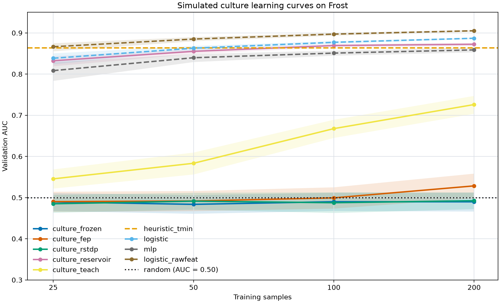

# NeuroRover: a frost-guard robot driven by a simulated neuron culture

- **Team ID:** TEAM_ID_HERE
- **Sponsor prizes entered:** none



## Problem

Companies like Cortical Labs and FinalSpark rent out living neuron cultures on electrode arrays, and the pitch is that biological neurons learn from far fewer examples than silicon. Testing that is expensive (Cortical Cloud is about $300 a week per unit) and most of the work isn't the neurons anyway. It's the plumbing: encoding a task into stimulation, reading spikes back out, closing the loop fast enough, and having a fair benchmark to compare against.

So we built the whole pipeline with no living cells. A simulated culture sits behind the real Cortical Labs CL API, it controls a "frost-guard robot" on a task built from the hackathon's freeze data, and we benchmark it against ordinary models at matched sample counts. When someone does pay for wetware time, the same code and the same benchmark run on real neurons.

A good result here is not "the simulation learns." It's a working harness that can tell you whether a culture learns, and how it compares to logistic regression given the same 25 to 200 examples.

## What we built

The robot's job: every station-night, decide whether to deploy frost protection (cover or heater) or hold. It sees lagged weather from 3 to 7 days earlier, plus season and location, from the `freeze-preparation` challenge data (NOAA stations, 96k training rows). The answer is whether that night's low actually went below 0 C.

1. **Simulated culture** (`neurorover/culture/core.py`). 1,024 Izhikevich neurons (80% excitatory, 20% inhibitory) on an 8x8 grid of electrodes, 16 neurons per electrode, with distance-dependent local wiring plus a sparse projection from the sensory rows to the motor rows. We tuned it so the spontaneous activity looks culture-like: about 5 Hz per neuron and a network burst every 2.5 s or so. Stimulating an electrode raises its own firing about 9x over sham (14.3 vs 1.6 spikes per 20 ms), much less on its neighbours, then there's a short post-stimulus suppression.
2. **Electrode map and codec** (`neurorover/interface/codec.py`). Electrodes 0 to 13 are sensory: each feature becomes 0 to 4 pulses at 100 Hz on its own electrode. Electrodes 40 to 47 vote DEPLOY and 48 to 55 vote HOLD (spike counts in a 50 ms window). 56 to 59 carry feedback and 60 to 63 carry the reward signal for R-STDP.
3. **Five ways for the culture to learn:**
   - `culture_frozen`: no plasticity, fixed motor readout. This is the control.
   - `culture_fep`: DishBrain-style feedback. A correct decision gets a predictable synchronous burst; a wrong one gets random pulses. The culture never sees a reward number, and STDP runs underneath.
   - `culture_rstdp`: reward-modulated STDP with eligibility traces on the sensory-to-motor synapses. The "dopamine electrode" is a modelling assumption; a real dish doesn't have one.
   - `culture_teach`: paired-stimulation teaching. After every trial we replay the sensory pattern and stimulate the correct motor region 3 ms after each sensory pulse (and the other region 3 ms before), so spike-timing plasticity strengthens the sensory-to-correct-motor pathway. It needs the label but only uses stimulation, so the same protocol could run on a real MEA.
   - `culture_reservoir`: the culture stays frozen and a logistic readout is trained on its 64-electrode spike counts (the Brainoware approach). Here the learning happens in silicon.
4. **Real CL API path** (`neurorover/culture/izh_source.py`, `neurorover/run_cl.py`). The culture is a `cl.sim.SimulatorDataSource`, so the loop uses `cl.open()`, `neurons.loop()`, stim plans and `tick.analysis.spikes`, the same calls you'd make on a CL1. Pass `--hardware` and it registers no simulated source.
5. **Benchmark** (`neurorover/bench.py`). There are 9 conditions, 10 seeds, and training budgets of 25, 50, 100 and 200 class-balanced samples. Every condition is scored by AUC on the same fixed validation subset (150 freeze nights, 150 non-freeze).
6. **Held-out submission** (`neurorover/submit_heldout.py`). The reservoir culture and a matched logistic model each produce a full freeze-challenge submission (37,842 rows). Both pass the challenge's `check_submission.py` (outputs in `neurorover/submissions/`).
7. **Demo pages** (`demo/index.html`, `demo/lab.html`). `lab.html` is a lab-console view: the electrode well, scrolling voltage traces (waveform shapes are synthesized from the logged spike times), a 64-channel raster and a per-run trial explorer with CSV downloads.
   `demo/index.html`: Evaluation mode plays back recorded trials: the electrode grid lights up with spikes, the robot deploys or holds, and a scoreboard keeps count. Training mode shows the first 40 training trials with the feedback phase, a rolling accuracy line, weight drift, and a heatmap of which electrodes fire.
8. **Per-run signal logs** (`neurorover/record_run.py`). One command saves every spike and stim of a run as CSV under `runs/<condition>_s<seed>/`, plus per-trial results, per-electrode counts for each trial window, and weight drift for the plastic conditions. Two example runs are committed (about 5 MB each, roughly 350k spikes).

9. **3D desktop app** (`app/`, Electron + three.js). The rover is built at true scale from the real parts in `hardware/BOM.md` (21 line items, about $1,190 and 10.8 kg, with estimates marked); hover any part for its spec, and drive physics use the BOM's motor torque, wheel size and mass. A Fleet tab shows every cloud VM training at once as live tiles, each of which can pop out into its own window. A 3D dish with all 1,024 model neurons lighting up as they spike, stim beams by kind, and a field scene where a rover (simple rigid-body physics) drives out and drops a mass-spring frost cover on DEPLOY nights. It plays any recorded run, shows accuracy, weight drift and learning curves, and can start a new recorded run with a live log. Launch with `app\start.bat` or `cd app && npm install && npm start`.
10. **Cloud fleet dashboard** (`fleet/`). `python fleet/server.py` serves http://localhost:8770, a live view of the Freestyle VMs running benchmark shards (CPU, memory, progress, log tail) with launch / collect / teardown.
11. **Weather world model** (`neurorover/world/`). Fitted on the training split only: per-station seasonal means plus a VAR(1) on daily min/max temperature anomalies, reconstructed from the lagged features. One-day-ahead error on validation is 2.27 C for the daily low, against 2.51 C for persistence and 3.35 C for climatology. It can imagine new station-nights in the same 15-feature format (imagined freeze rate 5.6% vs 5.9% real), and `env.py` wraps a station's season as a gym-style environment (reward -1 per deployment, -10 for an unprotected freeze night).

What's incomplete: we never ran on real neurons. Seeds 10 to 49 and the learning-rate runs ran on 10 Freestyle VMs (`sweep/run_sweep.sh`, `sweep/run_sens.sh`); everything else ran locally.

## Run or view the demo

You need Python 3.12 (the CL SDK requires it) and the hackathon resources repo cloned into `resources/` (the code reads `resources/challenges/freeze-preparation/09-freeze/data.json.gz`). The `VAR=1 cmd` lines need bash (Git Bash on Windows).

```sh
python -m venv .venv
.venv/Scripts/pip install cl-sdk==1.0.0 numpy matplotlib      # bin/ instead of Scripts/ on mac/linux

# one benchmark job (30 s to 2 min). Results are committed, so it skips silently
# if neurorover/results/<condition>_s<seed>.json exists; delete that file to rerun
.venv/Scripts/python -m neurorover.bench --condition culture_reservoir --seed 0
# full grid
.venv/Scripts/python -m neurorover.bench --all --seeds 10 --procs 7   # takes a while; results already in neurorover/results/
.venv/Scripts/python -m neurorover.analysis.summarize   # writes neurorover/analysis/summary.md
.venv/Scripts/python -m neurorover.analysis.plots

# the same task through the real Cortical Labs API (simulator)
CL_SDK_ACCELERATED_TIME=1 CL_SDK_VISUALISATION=0 \
  .venv/Scripts/python -m neurorover.run_cl --condition culture_reservoir --seed 0 --budget 25 --eval 100   # about 10 s with --eval 40
.venv/Scripts/python -m neurorover.scripts.verify_cl_source   # reactivity + latency check

# log every spike and stim of one run to runs/culture_fep_s0/
.venv/Scripts/python -m neurorover.record_run --condition culture_fep --seed 0

# demo page (opening index.html as a file won't work; it fetches demo_data.json)
.venv/Scripts/python -m http.server 8765 -d demo   # open http://localhost:8765
```

## Evidence and limitations

Validation AUC, mean over 50 seeds (10 local, 40 on Freestyle cloud VMs), 95% bootstrap CIs (full table in `neurorover/analysis/summary.md`):

| Condition | 25 | 50 | 100 | 200 |
|---|---:|---:|---:|---:|
| culture_frozen | 0.49 | 0.48 | 0.49 | 0.49 |
| culture_fep | 0.49 | 0.49 | 0.50 | 0.53 |
| culture_rstdp | 0.49 | 0.49 | 0.49 | 0.49 |
| culture_teach | 0.55 | 0.58 | 0.67 | 0.73 |
| culture_reservoir | 0.83 | 0.86 | 0.87 | 0.87 |
| logistic (same quantized input) | 0.84 | 0.86 | 0.88 | 0.89 |
| MLP (same quantized input) | 0.81 | 0.84 | 0.85 | 0.86 |
| logistic (raw features) | 0.87 | 0.89 | 0.90 | 0.91 |
| rule: low 3 days ago | 0.86 | 0.86 | 0.86 | 0.86 |
| random | 0.50 | 0.50 | 0.50 | 0.50 |

What we found:

- **Paired-stimulation teaching is the one rule where the simulated neurons learn by themselves.** `culture_teach` goes from 0.55 AUC at 25 samples to 0.73 at 200 (50 seeds), and beats the frozen control at every budget (+0.06 at 25, +0.24 at 200, paired bootstrap CIs exclude zero). It varies a lot by seed and it's still below logistic regression, so it is slower to learn, not faster.
- **Training in imagination helps the taught culture.** Before its real nights, the culture got 150 nights imagined by the weather world model (8 seeds, full report in `neurorover/world/REPORT.md`). With 25 real nights, AUC went from 0.56 to 0.67 (+0.11, 95% CI [+0.07, +0.15]); with 50 real nights, from 0.61 to 0.69 (+0.08). Logistic regression barely moved (+0.02 and +0.01), since it was already near its ceiling. The catch: the imagination arm also gets 150 extra teaching trials, so this doesn't separate "imagined data" from "more trials". What it shows is that imagined nights can stand in for scarce labelled ones. In whole-season tests (60 real nights at the three coldest stations), the culture lost about -95 reward per season vs -60 for always deploying and -72 for a simple temperature rule, because its deploy threshold isn't calibrated to the costs.
- **The reward-only cultures didn't learn.** Neither DishBrain-style feedback nor R-STDP got far from chance at any budget. Over 50 seeds, FEP beat the frozen control only at 200 samples (+0.04), and that isn't corrected for multiple comparisons. Two public DishBrain replications on GitHub (dishbrain-playground and dishbrain-snn-rstdp) hit the same wall (plain STDP, and reward-modulated STDP that changed weights without playing better).
- **Turning up the R-STDP learning rate is the one place we saw a learning trend.** At the default rate (0.02) the weight changes per trial are tiny. At lr=5 (10 seeds), AUC climbs from 0.52 at 25 samples to 0.59 at 200, against 0.52 for the frozen culture on the same seeds. That's still far below the reservoir or logistic regression, and we only tried three rates. The FEP condition doesn't use the lr setting at all (its STDP step size is fixed), so the FEP rows in `neurorover/analysis/sensitivity.md` are identical on purpose. Every setting we ran is in that file; none was picked by looking at the evaluation set.
- **The reservoir culture works, but it's no better than logistic regression.** It's level with logistic at 25 samples, significantly behind at 50 and up, and significantly ahead of a small MLP at 25 to 100 samples. A one-feature rule (the low 3 days earlier) gets 0.86 with no training at all, so this task is easy and the interesting part is the low-sample end. In this model the culture is a decent random feature map, and the learning comes from the silicon readout.
- **The CL API path matches the fast harness.** On the same 100 validation rows, reservoir AUC was 0.89 through the CL API and 0.87 through the direct harness (one seed; a 40-row run gave 0.84, so the gap is noise). Stimulating electrode 5 through the API gave 14.3 spikes per 20 ms window against 1.6 for sham, with the first evoked spike about 1.9 ms (simulated) after the pulse. Accelerated mode ran 2 to 12x faster than real time.

What this doesn't answer:

- **Whether real neurons are more sample-efficient.** A simulation learning (or failing to) says nothing about that. If a simulated culture had learned well, it would actually weaken the case for wetware.
- **Whether a better plasticity model would learn.** Our culture is a reasonable but uncalibrated model. We matched firing and burst rates by eye to typical culture numbers; we didn't fit it to real MEA recordings.
- **The 37,842-row held-out submission can't be scored by us.** The held-out labels are withheld.
- **Two choices are on us, not the data.** The task is a contextual bandit (one decision, one outcome), and we balanced the training stream 50/50 because freezes are only about 5% of nights.

## Data and permissions

- **Freeze-preparation data:** from the DNAForge hackathon resources repo (`challenges/freeze-preparation/09-freeze`), derived from NOAA station records. See that folder's `NOTICE.md` for source and terms. Not redistributed here; clone the resources repo to run.
- **Cortical Labs CL SDK** (`cl-sdk` 1.0.0 on PyPI): used through its public API and simulator.
- **Earlier task:** we first tried the soil-moisture data (KU Leuven DRIP, CC BY 4.0) and dropped it. Calibration error barely correlated with any feature (|r| < 0.16): the starter's own ranking got 0.24 precision@17 against 0.20 for random, and a linear probe got AUC 0.50 to 0.58. Every condition would have sat at chance.
- No credentials are in this repo.

## Next step

Run the exact same benchmark on real neurons: a week on Cortical Cloud with `run_cl.py --hardware`, same encoding, same 300 validation nights, same 25 to 200 sample budgets, frozen-readout and feedback conditions side by side. If a living culture with DishBrain-style feedback beats the frozen control and gets near logistic regression at 25 samples, that's the first real evidence for the sample-efficiency claim. If it doesn't, the harness says so for $300 instead of a lab build-out.
