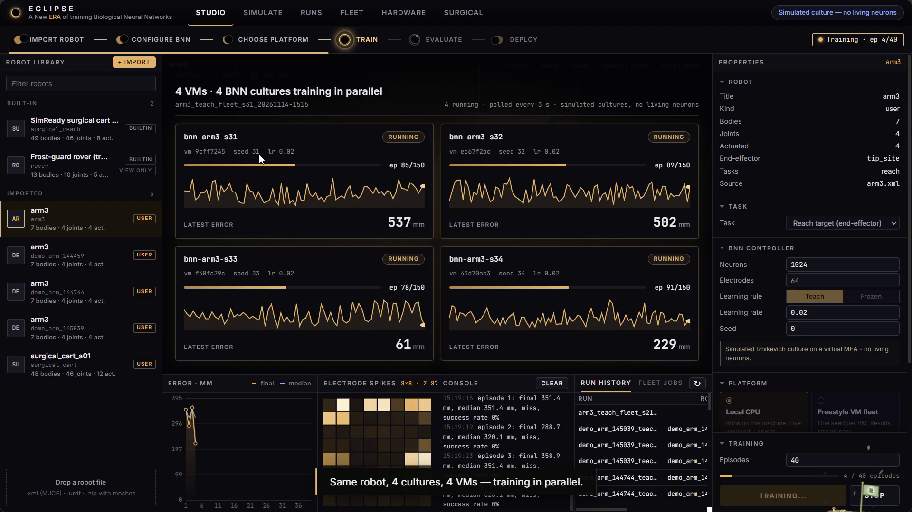

# Eclipse: A New ERA of training Biological Neural Networks

- **Team ID:** TEAM_ID_HERE
- **Sponsor prizes entered (if any):** none



## Problem

Biological neural networks (BNNs) are living neuron cultures grown on electrode arrays. Companies like Cortical Labs and FinalSpark now rent them out, and the claim is that they learn from far fewer examples than silicon. Two groups have this problem:

- **Wetware researchers.** Testing the claim is expensive: Cortical Cloud costs about $300 a week per unit. Most of the work isn't the neurons anyway. It's the plumbing: encoding a task into stimulation, decoding spikes into actions, closing the loop fast enough, and having a fair benchmark.
- **Robotics teams who want to try BNN controllers.** There is no tool that lets you take *your* robot, train a BNN controller for it in simulation at scale, and then hand a lab a protocol it can run on a living culture.

**A successful result** is not "the simulation learns." It is a platform that does three things:
1. Trains any robot with a BNN controller in simulation, across many VMs in parallel.
2. Tells you honestly whether the culture learns, against a fair baseline.
3. Exports the closed-loop protocol (electrode map, encoder/decoder, teaching schedule, calibration and safety limits) so the same experiment can run on real neurons.

## What we built

**Eclipse** is a desktop studio, Python backend and website for training robots with BNN controllers. Every controller in this repo is a **simulated** Izhikevich neuron culture. No living neurons were used.

### Works today

1. **Eclipse desktop app** (`app/`, Electron + three.js + GSAP). It walks through six steps: Import → Configure BNN → Choose platform → Train → Evaluate → Deploy.
   - **Import any robot:** MJCF, URDF or a zip with meshes. The app auto-detects the end-effector and adds actuators if the model has none.
   - **Live training:** a 3D viewport, an 8×8 electrode spike heatmap and an error chart.
   - **Fleet grid:** one card per VM with live episode progress and an error sparkline.
   - **Run history:** every past run can be replayed in 3D or downloaded as a zip.
   - **Deploy:** exports a sim-to-real bundle and dry-runs it against a mock electrode array.
   - The original tabs are still there: the culture dish, the rover field, the hardware BOM and the surgical robot.
2. **Studio backend** (`bnn_platform/studio/`): `python -m bnn_platform studio list|import|scene|train|fleet-status|runs|replay|pack`.
   - **Generic BNN reach task:** works for any MuJoCo-loadable robot. It generalizes the paired-stimulation "teach" rule used for the surgical robot.
   - **Where it trains:** locally, or on N Freestyle VMs with one seed per VM; results are pulled back automatically.
   - **Protocol:** the UI talks to the backend through a JSON-lines interface, documented in [`docs/STUDIO_CONTRACT.md`](docs/STUDIO_CONTRACT.md).
3. **Sim-to-real export** (`bnn_platform/transfer/`, [`docs/SIM_TO_REAL.md`](docs/SIM_TO_REAL.md)).
   - **What it packages:** a trained run, as a hardware bundle containing:
     - electrode map and encoder/decoder;
     - teaching protocol and stimulation schedule;
     - calibration protocol;
     - safety limits;
     - a simulated reference recording.
   - **Targets:**
     - generic MEA (tested against a mock array);
     - Cortical Labs CL1 (backend written against the `cl` SDK but never executed);
     - MCS and MaxWell (layout stubs).
   - **Runtime bridge:** a mock array runs the loop end to end (calibrate, remap electrodes, closed-loop control). Its validator runs 48 checks per bundle.
4. **Simulated culture** (`neurorover/culture/core.py`): 1,024 Izhikevich neurons (80% excitatory, 20% inhibitory) on an 8×8 electrode grid. It is tuned to culture-like activity (about 5 Hz per neuron, network bursts every ~2.5 s, 9× evoked response to stimulation). Five learning rules are implemented:
   - frozen (no plasticity, the control);
   - DishBrain-style feedback;
   - reward-modulated STDP;
   - paired-stimulation teaching;
   - a reservoir with a trained logistic readout.
   The culture also runs behind the real Cortical Labs CL API (`neurorover/run_cl.py`), so the same loop code targets a CL1.
5. **Robots and tasks.**
   - **Frost-guard decision task:** the original benchmark. Every station-night, decide whether to deploy frost protection or hold, using NOAA freeze data. 10 conditions, 50 seeds, 25 to 200 training samples (`neurorover/bench.py`).
   - **MuJoCo rover** (`sim/`): PPO drives to a field station and deploys a frost cover, then runs a 30-night culture-driven season.
   - **NVIDIA SimReady surgical cart** (`surgical/`): a 47-body, 46-joint MuJoCo model of a four-arm surgical cart. A culture controls arm 1. Procedural stress scenarios and a learned world model are adapted from ORBIT-Surgical, SuFIA and SuFIA-BC (mapping in [`docs/RESEARCH_PAPERS.md`](docs/RESEARCH_PAPERS.md)).
   - **Example 4-joint arm** (`bnn_platform/examples/arm3.xml`), used to test the import-anything path.
6. **Parallel training on Freestyle VMs** (`sweep/`, `bnn_platform/studio/fleet.py`): benchmark shards, the surgical learning-rate sweep and the scenario suite all ran on Freestyle VMs.
7. **Weather world model and environment data** (`neurorover/world/`, `neurorover/envdata/`):
   - the world model is a VAR(1) on temperature anomalies, used to imagine training nights;
   - Open-Meteo conditions are joined to the NOAA stations.
8. **Website** (`landing/`): a three.js scroll journey (eclipse → neuron culture → robot → VM fleet), the demo video, results and the Windows download.

### Still incomplete

- **Real neurons:** nothing has been run on living tissue.
- **Surgical reaching:** the BNN controller does not yet reach surgical targets reliably (see Evidence).
- **Vendor hardware:** the CL1 backend is untested, and MCS and MaxWell are stubs. All stimulation defaults must be validated against vendor and lab limits.
- **Untested import paths:** URDF and zip import are written but have not been tried with real third-party files.
- **Packaged app:** the self-test and the "Python missing" dialog have not been verified in the packaged build, and it has not been tested on a clean machine.
- **Single-seed results:** the rover physics policy and the arm3 result each come from one training seed.
- **Partial data:** the environment-data archive is only partially fetched.

## Run or view the demo

**View without installing anything:**
- **Website:** https://eclipse-blush-phi.vercel.app (public).
- **Demo video (30 s):** [`demo/video/eclipse_demo.mp4`](demo/video/eclipse_demo.mp4). It shows a simulated culture training a 4-joint arm live, then 4 real Freestyle VMs training 4 cultures in parallel. A longer 2:15 walkthrough covering import, training, fleet, run history and export is at [`demo/video/bnn_robot_studio_demo.mp4`](demo/video/bnn_robot_studio_demo.mp4); it was recorded before the rename to Eclipse.
- **Windows download** (v0.1.0, 172 MB, unsigned): https://sr6t0xysfmhdyfpp.public.blob.vercel-storage.com/downloads/Eclipse-0.1.0-win-x64.zip
  - SHA-256 is listed in [`landing/downloads/manifest.json`](landing/downloads/manifest.json).
  - Needs Windows 10/11 x64 and Python 3.10–3.12 installed (`py` or `python`).
  - On first launch it creates its own environment in `%LOCALAPPDATA%\Eclipse`.

**Run from source** (Python 3.12 and Node 20+; bash for the `VAR=1 cmd` lines, which means Git Bash on Windows):

```sh
python -m venv .venv
.venv/Scripts/pip install -r requirements-eclipse.txt matplotlib   # bin/ instead of Scripts/ on mac/linux

# Eclipse desktop app
cd app && npm install && npm start            # opens the Studio tab
#   scripted 30 s tour: node_modules/electron/dist/electron.exe . --demo-short --demo-fake-fleet
cd ..

# Studio from the command line
.venv/Scripts/python -m bnn_platform studio import --file bnn_platform/examples/arm3.xml
.venv/Scripts/python -m bnn_platform studio train --robot arm3 --episodes 20          # local, streams JSON lines
.venv/Scripts/python -m bnn_platform studio train --robot arm3 --platform fleet --vms 4 --dry-run
.venv/Scripts/python -m bnn_platform.transfer export --run surgical/results/culture_teach.pkl --target generic
.venv/Scripts/python -m bnn_platform.transfer run --bundle surgical/results/export/generic --backend mock --episodes 2

# Frost-guard benchmark (results are committed; a job skips if its result JSON exists)
.venv/Scripts/python -m neurorover.bench --condition culture_reservoir --seed 0
.venv/Scripts/python -m neurorover.analysis.summarize      # writes neurorover/analysis/summary.md
CL_SDK_ACCELERATED_TIME=1 CL_SDK_VISUALISATION=0 \
  .venv/Scripts/python -m neurorover.run_cl --condition culture_reservoir --seed 0 --budget 25 --eval 40
```

**Before you start:**
- **Freeze-benchmark data:** clone the hackathon resources repo into `resources/`. The code reads `resources/challenges/freeze-preparation/09-freeze/data.json.gz`.
- **Real fleet runs:** need a Freestyle account (`npx freestyle@latest login`). Without one, use `--dry-run`, or `--demo-fake-fleet` in the app.
- **This repository is private:** judges need to be added as collaborators to open it.
- **If a service is down at the table:** the committed video, screenshots (`app/shot-eclipse-*.png`, `landing/assets/`) and result files below are the evidence.

## Evidence and limitations

All controllers below are simulated cultures. Each result names its baseline.

**1. Frost-guard decision benchmark.** Validation AUC, mean over 50 seeds (10 local, 40 on Freestyle VMs), with 95% bootstrap CIs. Full table: [`neurorover/analysis/summary.md`](neurorover/analysis/summary.md).

| Condition | 25 | 50 | 100 | 200 |
|---|---:|---:|---:|---:|
| culture_frozen (control) | 0.49 | 0.48 | 0.49 | 0.49 |
| culture_fep (DishBrain-style) | 0.49 | 0.49 | 0.50 | 0.53 |
| culture_rstdp | 0.49 | 0.49 | 0.49 | 0.49 |
| culture_teach (paired stimulation) | 0.55 | 0.58 | 0.67 | 0.73 |
| culture_reservoir | 0.83 | 0.86 | 0.87 | 0.87 |
| logistic (same quantized input) | 0.84 | 0.86 | 0.88 | 0.89 |
| MLP (same quantized input) | 0.81 | 0.84 | 0.85 | 0.86 |
| logistic (raw features) | 0.87 | 0.89 | 0.90 | 0.91 |
| rule: low 3 days ago | 0.86 | 0.86 | 0.86 | 0.86 |

- **Paired-stimulation teaching** is the only rule where the culture learns by itself. It beats the frozen control at every budget (+0.24 at 200; paired CIs exclude zero) but stays below logistic regression. So it learns more slowly, not faster.
- **Reward-only rules don't learn.** DishBrain-style feedback and R-STDP stay near chance. Two public DishBrain replications hit the same wall.
- **The reservoir culture** matches logistic regression at 25 samples and falls behind at 50 and up. Here the learning comes from the silicon readout.
- **Imagined training nights** from the world model raised teach AUC from 0.56 to 0.67 at 25 real nights (+0.11, CI [+0.07, +0.15]; [`neurorover/world/REPORT.md`](neurorover/world/REPORT.md)). This doesn't separate "imagined data" from "more teaching trials".
- **The CL API path** matches the fast harness: 0.89 vs 0.87 AUC on the same 100 rows, one seed.

**2. Surgical cart, paper-inspired stress scenarios on 4 Freestyle VMs** (12 episodes per cell). Success rate / median final error; success means within 1 cm. Source: [`surgical/RESEARCH_RESULTS.md`](surgical/RESEARCH_RESULTS.md).

| Scenario | culture_teach | culture_frozen | IK (DLS) |
|---|---|---|---|
| nominal | 0%, 288 mm | 0%, 485 mm | 100%, 3.3 mm |
| novel targets | 0%, 345 mm | 0%, 600 mm | 83%, 5.1 mm |
| calibration bias | 0%, 261 mm | 0%, 464 mm | 67%, 9.3 mm |
| measurement noise | 0%, 245 mm | 0%, 497 mm | 100%, 3.1 mm |
| actuator mismatch | 0%, 244 mm | 0%, 470 mm | 100%, 2.7 mm |
| combined stress | 0%, 373 mm | 0%, 580 mm | 50%, 9.8 mm |

- **Learning but no hits:** the taught culture ends about 2× closer than the frozen one, but reaches no target. IK and PPO (98% on 50 held-out targets; [`surgical/REPORT.md`](surgical/REPORT.md)) are engineering references.
- **Learning-rate sweep:** 4 rates on 4 VMs. None reached a target.
- **World model:** beats a no-motion baseline by 23% one step ahead (14.1 vs 18.3 mm), but not at 10 steps.

**3. Example 4-joint arm (Studio generic path).** One seed, 20 episodes, 10 held-out targets with learning off.
- **Taught culture:** median error went from **394 mm to 91 mm**, and it reached 1 of 10 targets.
- **Frozen control:** got worse on the same targets (394 → 419 mm).

**4. MuJoCo rover.**
- **Driving:** PPO warm-started from 120 demonstration drives reached **72%** success on 100 randomized episodes, against **59%** for the hand-written controller. Plain PPO without demonstrations reached 0%.
- **Season:** a 30-night culture-driven season protected 3 of 11 freeze nights. Source: [`sim/README.md`](sim/README.md).

**5. Sim-to-real bundle.**
- **Fidelity:** replaying the bundle reproduces the simulated controller's actions exactly (maximum difference 0.0).
- **Mock run:** calibration found 9 of 64 electrodes responsive. Refitting the decoder didn't pass acceptance (held-out R² below the floor), so the bundle kept the simulation's decoder.
- **Remapping hurts:** on hardware with unusable electrodes, moving their roles elsewhere degrades the trained culture (final error 522 vs 181 mm). This confirms that trained weights are tied to electrode layout.

**What these tests leave unanswered:**
- **Real neurons:** whether living neurons are more sample-efficient, or work with this protocol at all. A simulation learning or failing says nothing about wetware.
- **Better models:** whether a better-calibrated plasticity model, or a decoder fitted to the culture's spikes, would reach surgical targets. Our culture was matched to typical activity by eye, not fitted to MEA recordings.
- **Seed variance:** the rover policy and the arm3 result are single-seed.
- **Held-out scoring:** the 37,842-row freeze submission can't be scored by us, because the labels are withheld.

## Data and permissions

- **Freeze-preparation data:** from the hackathon resources repo (`challenges/freeze-preparation/09-freeze`), derived from NOAA station records. Terms are in that folder's `NOTICE.md`. Not redistributed here; clone the resources repo to run.
- **Environment data:** from the Open-Meteo historical archive (CC BY 4.0), joined to the challenge stations. The archive is only partly fetched.
- **Surgical cart:** adapted from "Robotic System A01" by NVIDIA (SimReady assets), CC BY 4.0. It was converted from USD to MuJoCo, losing textures, some internal joints and per-asset friction. See [`surgical/ATTRIBUTION.md`](surgical/ATTRIBUTION.md).
- **Field props:** seven NVIDIA SimReady props, CC BY 4.0. See [`assets/simready/ATTRIBUTION.md`](assets/simready/ATTRIBUTION.md).
- **Papers referenced:** ORBIT-Surgical (arXiv:2404.16027), SuFIA (arXiv:2405.05226) and SuFIA-BC (arXiv:2504.14857). We used their ideas only, not their code or assets.
- **Software:**
  - Cortical Labs CL SDK 1.0.0 (PyPI), used through its public API and simulator;
  - MuJoCo (Apache-2.0);
  - three.js (MIT);
  - GSAP 3.13;
  - Electron (MIT).
- **Earlier task we dropped:** the KU Leuven DRIP soil-moisture data (CC BY 4.0). Every model sat at chance on it (|r| < 0.16 with any feature).
- **Credentials:**
  - None are committed.
  - Freestyle uses the CLI's own stored login.
  - The Vercel Blob token lives only in the git-ignored `landing/.env.local`.
  - Local runs and imported robots (`user_runs/`, `user_robots/`) are git-ignored.

## Next step

**Run the exact same protocol on real neurons.** Spend one week on Cortical Cloud with `run_cl.py --hardware` and an exported Eclipse bundle:
- the same encoding and the same 300 validation nights;
- the same 25 to 200 sample budgets;
- the frozen-readout, feedback and paired-stimulation conditions side by side.

If a living culture beats the frozen control and gets near logistic regression at 25 samples, that is the first real evidence for the sample-efficiency claim. If it doesn't, the harness says so for about $300 instead of a lab build-out.
